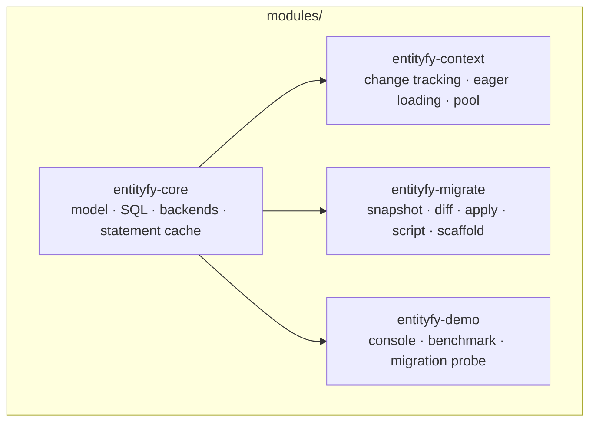
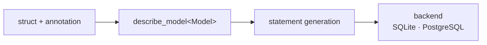
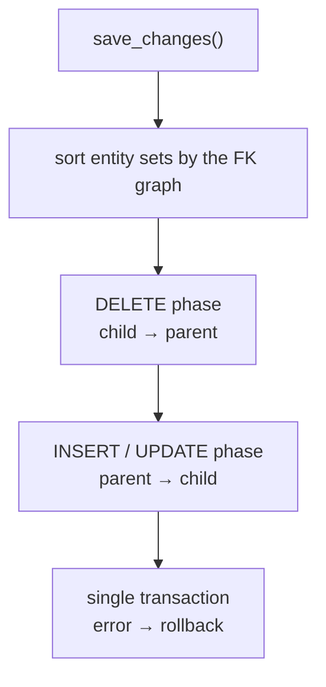

# entityfy

An ORM and migration toolkit built on C++26 `std::meta`. Models are plain C++ structs; the table
schema, SQL, migration files, and scaffold output are generated at compile time through
reflection. Designed as the C++ counterpart of Entity Framework Core: the same concepts
(model, migration, snapshot, DbContext, eager loading, optimistic concurrency), expressed with
C++26 language features.

## Architecture



Dependencies flow one way only: `core` depends on no module, and `context` and `migrate` use only
`core`.

The path from model to SQL:



## Quick start

```cpp
#include <entityfy/entityfy.hpp>

struct [[= entityfy::table{"users"}]] user
{
    [[= entityfy::id, = entityfy::auto_increment]]
    std::int64_t id = 0;

    [[= entityfy::unique, = entityfy::indexed, = entityfy::not_null, = entityfy::varchar{320}]]
    std::string email;

    [[= entityfy::not_null, = entityfy::varchar{120}]]
    std::string name;
};

int main()
{
    entityfy::client db{"sqlite://app.db"};
    db.migrate<user>();

    db.insert(user{.email = "ada@example.com", .name = "Ada"});

    const auto found = db.find_one(entityfy::where(&user::email).eq("ada@example.com"));
    return found ? 0 : 1;
}
```

Applications that need change tracking use the `entityfy-context` module, which mirrors Entity
Framework Core:

```cpp
struct app_context : entityfy::db_context
{
    using entityfy::db_context::db_context;

    entityfy::db_set<user> users{*this};
    entityfy::db_set<post> posts{*this};
};

app_context ctx{"sqlite://app.db"};
ctx.migrate_all();                             // tables in foreign key order, derived by reflection

ctx.users.add(user{.email = "ada@example.com", .name = "Ada"});
ctx.users.add(post{.user_id = 1, .title = "first"});

const auto result = ctx.save_changes();        // single transaction, generated ids written back

auto* ada = ctx.users.find(1);
const auto posts = ctx.users.include<post>({ada});   // foreign key read from the annotation
```

The `DbSet` member is the only thing that has to be declared: its table, columns, primary key and
relationships all come from the annotations through reflection.

## Modules

| Module | Responsibility | Documentation |
|---|---|---|
| `entityfy-core` | Model/annotation system, DDL generation, query DSL, SQLite + PostgreSQL backends, statement cache, value converter | [docs/core.md](docs/core.md) |
| `entityfy-context` | Identity map, snapshot-based change tracking, partial UPDATE, FK dependency ordering, eager loading, context pool | [docs/context.md](docs/context.md) |
| `entityfy-migrate` | Snapshot, diff, apply/rollback, runnable SQL script, scaffold, CLI | [docs/migration.md](docs/migration.md) |

## entityfy-core

- **Annotation-based model**: `primary_key`, `auto_increment`, `unique`, `indexed`,
  `not_null`, `varchar{n}`, `text`, `blob`, `json`, `uuid`, `decimal{p,s}`, `date`, `time`,
  `timestamp`, `created_at`, `updated_at`, `references{...}`, `ignore`.
- **query DSL**: `where`, `order_by`, `take`, `skip`, `select` (projection), `sum`, `avg`,
  `min`, `max`, `count`, grouped aggregates (`count_by`, `sum_by`, `group_count`,
  `group_count_having`).
- **Prepared statement cache**: the SQLite backend keeps compiled statements in an LRU
  (default capacity 32); parameters are rebound on every execution, with no bind leakage.
- **Multi-row INSERT**: `insert_many` produces a single statement for models with explicit
  keys, split according to the batch parameter limit.
- **Value converter**: with `entityfy::value_converter<T>` your own type is written to and read
  from a single column (JSON, composite values, enum-like fields).
- **SQL logger**: `client::set_logger(...)` reports every statement before it executes.

## entityfy-context

- EF Core style surface: `db_context` / `db_set<T>` with `save_changes()`, `add()`, `find()`,
  `query()`, `include()`, `include_parent()`, `remove()`, `attach()`.
- Reflection driven: a declared `db_set<T>` supplies its table, columns, primary key and foreign
  keys; `model()` exposes the derived metadata and `migrate_all()` creates the tables parents-first.
- Identity map and snapshot-based change tracking; `save_changes()` writes only the changed
  columns.
- Control over tracking through `state(entity)`, `refresh`, `detach`, `clear`.
- **FK dependency order**: insert/update parent-first, delete child-first. In tables using
  `ON DELETE RESTRICT`, a parent and its child can be deleted in the same save.
- Eager loading: `include<child>` (1:N), `include_parent<parent>` (N:1), two- and three-table
  joins. The foreign key is read from the `references` annotation, so no member pointer or join
  condition is passed.
- Navigation fixup: the parent's `std::vector<Child*>` member is filled with the tracked
  children.
- Bulk operations: `query().remove_all()`, `query().assign(...).update_all()`.
- `db_context_pool`: lease-based context reuse; when the lease is released the change tracker is
  cleared.
- `save_changes_async()`: moves saving to a worker thread; saves are serialized by a mutex inside
  the context. This is not I/O asynchrony; the drivers run synchronously.

## entityfy-migrate

```bash
entityfy_migrate snapshot            # schema.snapshot.json from the models
entityfy_migrate add "add nickname"   # writes the difference between snapshot and live schema to a migration file
entityfy_migrate plan                # SQL of the pending migrations
entityfy_migrate apply               # applies inside a transaction
entityfy_migrate status              # applied/pending migrations + schema drift
entityfy_migrate script              # generates runnable SQL
entityfy_migrate scaffold            # generates a C++ model header from the live schema
entityfy_migrate rollback            # reverts the last migration
entityfy_migrate rename-table <old> --to <new>   # renames the table in place
```

- Before applying, the expected schema is compared with the database; a mismatch raises an error.
- Destructive operations are rejected by default (`--allow-destructive`); a backup is taken
  beforehand.
- Migration files are protected by checksum; if a file is changed afterwards, applying stops.
- History table: `entityfy_schema_migrations` (`id`, `checksum`, `seq`, `applied_at`).

## Save order



Tables linked with `ON DELETE RESTRICT` can be deleted in the same save thanks to this ordering.

## Performance

The `entityfy_bench` harness compares three paths in the same process: the entityfy typed API,
raw SQLite (the statement is compiled once and reused), and raw SQLite (prepare on every call).
The methodology, the corrected baselines, and the limitations are in
[docs/benchmarks.md](docs/benchmarks.md).

SQLite, in-memory, 100.000 rows, 5 repetitions:

| Operation | entityfy | raw cached | raw prep-each | /cached | /prep |
|---|---:|---:|---:|---:|---:|
| find (primary key) | 1,98 µs | 0,88 µs | 3,05 µs | 2,25x | 0,65x |
| find_one (unique email) | 3,30 µs | 1,74 µs | 4,28 µs | 1,90x | 0,77x |
| exists (unique email) | 1,83 µs | 0,98 µs | 2,98 µs | 1,87x | 0,61x |
| find_many (LIKE, LIMIT 20) | 26,0 µs | 14,0 µs | 18,8 µs | 1,86x | 1,38x |
| count | 19,2 µs | 19,0 µs | 20,4 µs | 1,01x | 0,94x |
| update (read + write) | 7,36 µs | 4,39 µs | 8,69 µs | 1,68x | 0,85x |
| remove_by_id | 3,51 µs | 2,86 µs | 4,13 µs | 1,23x | 0,85x |

The effect of the statement cache is measured with an on/off comparison in the same process
(independent of machine load): primary key 1,97 µs → 4,53 µs (**2,30x**), unique email
3,05 µs → 5,81 µs (**1,90x**).

Multi-row INSERT (50.000 rows): row by row 351k rows/s, `insert_many` 1,40M rows/s
(**3,98x**).

PostgreSQL, local server, 5.000 rows:

| Operation | entityfy | raw prepared | raw params | /prepared | /params |
|---|---:|---:|---:|---:|---:|
| find (primary key) | 126,6 µs | 55,1 µs | 102,7 µs | 2,30x | 1,23x |
| find_one (unique email) | 123,8 µs | 57,0 µs | 102,7 µs | 2,17x | 1,21x |
| insert_many | 83k rows/s | — | — | — | — |

On PostgreSQL the absolute time is determined by network latency; the ORM layer's share is
1,2–2,3 times the raw driver. Absolute times can vary by up to a factor of two with machine load;
the ratios are more stable.

## Tests

```bash
ctest --preset release
```

39 CTest entries: 37 core Catch2 test executable entries (139 assertions) and the migrate/context
test binaries — which contain 9 and 16 scenarios respectively.
PostgreSQL tests run when `ENTITYFY_PG_URI` is provided; with `ENTITYFY_REQUIRE_PG=1` a skipped
test counts as a failure. Tests write to a temporary workspace and do not pollute the source tree.

## Build

Requirements: GCC 16.2+ (C++26 `-freflection`), CMake 3.30+. The PostgreSQL backend requires
`libpq`.

```bash
cmake --preset release
cmake --build --preset release
```

Outputs are collected under `build/release/bin`. If PostgreSQL `libpq` is not in a standard
location:

```bash
cmake -S . -B build/release -DCMAKE_BUILD_TYPE=Release \
  -DPostgreSQL_INCLUDE_DIR=<pgsql>/include -DPostgreSQL_LIBRARY=<pgsql>/lib/libpq.dll.a
```

Options: `ENTITYFY_ENABLE_SQLITE`, `ENTITYFY_ENABLE_POSTGRESQL`, `ENTITYFY_BUILD_TESTS`,
`ENTITYFY_BUILD_EXAMPLES`, `ENTITYFY_BUILD_DEMO`.

## Repository layout

```
entityfy/
├── CMakeLists.txt              superbuild
├── CMakePresets.json           dev / release / release-no-pg
├── cmake/Dependencies.cmake    sl3, taocpp::pq, nlohmann_json, Catch2, spdlog
├── docs/                       architecture, core, context, migration, benchmark, roadmap
└── modules/
    ├── entityfy-core/
    ├── entityfy-context/
    ├── entityfy-migrate/
    └── entityfy-demo/
```

Third-party dependencies are fetched once at the top level; SQLite is shared between modules
through `sl3`, and there is no second copy of SQLite.

## Limitations

- The PostgreSQL backend does not use a prepared statement cache; `taocpp::pq` does not expose
  `PQexecPrepared`. An adapter moving to raw libpq is required.
- `save_changes_async()` is a thread offload, not I/O asynchrony.
- The core does not perform dirty-column updates; partial UPDATE lives in the context layer.
- Column-split owned types and TPH inheritance are not supported. Composite/JSON values are
  stored through `value_converter`.
- There are no MySQL or SQL Server providers.
- Row reading is costly through `vector<vector<sql_value>>`; single-row reads need a separate
  path.

Roadmap: [docs/roadmap.md](docs/roadmap.md).

## Contributing

Local verification:

```bash
cmake --preset release
cmake --build --preset release
ctest --preset release
./build/release/bin/entityfy_bench 100000 5
```
