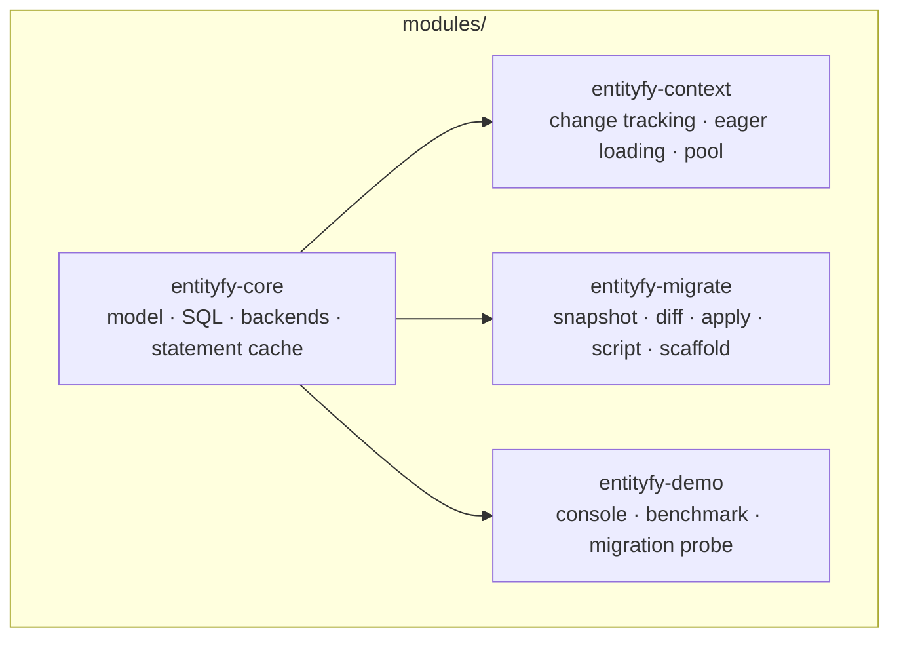
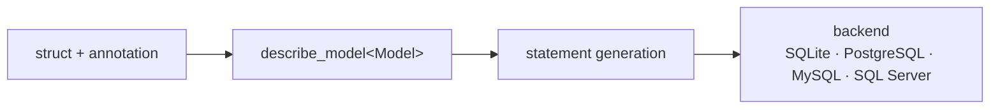
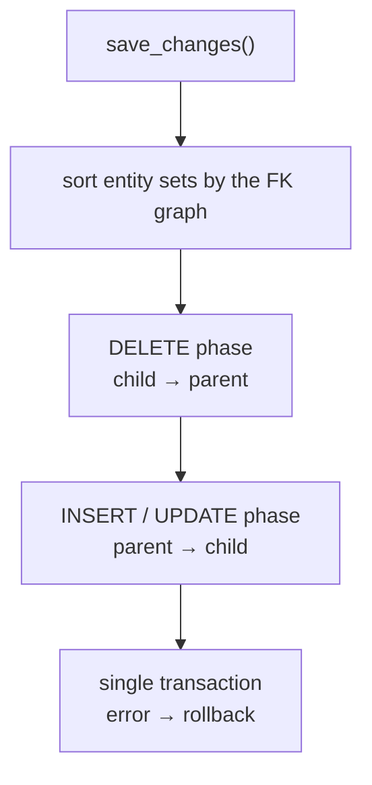

# entityfy

An ORM and migration toolkit built on C++26 `std::meta`. Models are plain C++ structs; the table
schema, SQL, migration files, and scaffold output are generated at compile time through
reflection. Designed as the C++ counterpart of Entity Framework Core: the same concepts
(model, migration, snapshot, DbContext, eager loading, optimistic concurrency), expressed with
C++26 language features.

## Architecture



Dependencies flow one way only: `core` depends on no module, and `context` and `migrate` use only
`core`.

The path from model to SQL:



## Quick start

The default entry point mirrors Entity Framework Core: a `db_context` holds `db_set<T>` members,
tracks the changes made to the entities it hands out, and saves them in one transaction.

```cpp
#include <entityfy/db_context.hpp>

struct [[= entityfy::table{"users"}]] user
{
    [[= entityfy::id, = entityfy::auto_increment]]
    std::int64_t id = 0;

    [[= entityfy::unique, = entityfy::indexed, = entityfy::not_null, = entityfy::varchar{320}]]
    std::string email;

    [[= entityfy::not_null, = entityfy::varchar{120}]]
    std::string name;
};

struct [[= entityfy::table{"posts"}]] post
{
    [[= entityfy::id, = entityfy::auto_increment]]
    std::int64_t id = 0;

    [[= entityfy::references{"users", "id", "CASCADE"}]]   // foreign key
    std::int64_t user_id = 0;

    [[= entityfy::not_null, = entityfy::varchar{200}]]
    std::string title;
};

struct app_context : entityfy::db_context
{
    using entityfy::db_context::db_context;

    entityfy::db_set<user> users{*this};
    entityfy::db_set<post> posts{*this};
};

app_context ctx{"sqlite://app.db"};
ctx.migrate_all();                             // tables in foreign key order, derived by reflection

ctx.users.add(user{.email = "ada@example.com", .name = "Ada"});
ctx.posts.add(post{.user_id = 1, .title = "first"});

const auto result = ctx.save_changes();        // single transaction, generated ids written back

auto* ada = ctx.users.find(1);
ada->name = "Ada Lovelace";                    // tracked: the next save_changes() writes it
const auto posts = ctx.users.include<post>({ada});   // foreign key read from the annotation
```

The `db_set` member is the only thing that has to be declared: its table, columns, primary key and
relationships all come from the annotations through reflection.

### Reading without tracking

Two paths avoid the tracker. `as_no_tracking()` returns full entities by value (EF Core's
`AsNoTracking()`), while `query().select(...)` returns tuples (EF Core's `Select(x => new
{ ... })`):

```cpp
const auto reports = ctx.users.as_no_tracking()
                        .where(entityfy::where(&user::name).eq("Ada Lovelace"))
                        .to_list();            // std::vector<user>, nothing attached
```

```cpp
for(const auto& [email, name]: ctx.users.query()
                                   .where(entityfy::where(&user::name).eq("Ada Lovelace"))
                                   .select(&user::email, &user::name))
{
    std::cout << email << ": " << name << '\n';
}
```

Both are read-only. `as_no_tracking().to_list()` hands out `const` rows, so editing one is a
compile error; `first()` returns a copy, and editing the copy simply never reaches the database
(measured tracking overhead: 1,39-1,52x per loaded row, see
[docs/benchmarks.md](docs/benchmarks.md)).

Eager loading works on both paths: `as_no_tracking().include<post>()` yields owning
`(user, std::vector<post>)` pairs, and the tracked `include`, `include_parent` and join paths
consume rows through `query_each` instead of buffering them.

Navigation can also be declared lazy instead of eager: a `[[= entityfy::ignore]]
entityfy::lazy<std::vector<post>> posts;` member (or `lazy<user> author;` for a reference) binds
when the entity enters the context and loads once through the identity map on first access.
`include` / `include_parent` fill the same handle from their single query, and a handle that
outlives the context fails with a typed error instead of touching freed state.

```cpp
struct user
{
    std::int64_t id = 0;
    [[= entityfy::not_null]] std::string email;

    [[= entityfy::ignore]] entityfy::lazy<std::vector<post>> posts;
};
```

### When not to open a context

`entityfy::client` is the layer the context itself is built on: statements, the query DSL and the
DDL, with no unit of work around them. Reach for it when nothing has to be tracked:

- bulk work and `insert_many` (one statement per batch, no per-row snapshot),
- batch jobs that never touch the context at all (inside a context, `as_no_tracking()` already
  skips the per-row snapshot - see above),
- one-shot tools and CLIs that should not construct a context at all.

```cpp
#include <entityfy/entityfy.hpp>

entityfy::client db{"sqlite://app.db"};
db.migrate<user>();

db.insert(user{.email = "ada@example.com", .name = "Ada"});

const auto found = db.find_one<user>(entityfy::where(&user::email).eq("ada@example.com"));
```

The context is a consumer of this layer, not a replacement: `db_set` builds its SQL and runs it
through `client::execute` / `client::query`.

## Examples

Every example is a complete, runnable program (built by default, output under
`build/release/bin`). They are the shortest way to see a feature end to end:

| Program | Shows |
|---|---|
| `entityfy_example_playground` | the core surface: annotated model, `migrate`, `insert` through `client` and `table<T>`, `find_many` with a typed filter |
| `entityfy_example_production_blog` | a realistic model set: enums, optional and JSON fields, dates, foreign keys, `insert_many`, a transaction, an embedded migration |
| `entityfy_example_migrations_sqlite` | a legacy table: drift report (`validate_schema`), additive vs destructive sync, `migrate_force`, applying a migration |
| `entityfy_console` | CLI shell: `entityfy_console bench [n]`, `entityfy_console ddl`, `entityfy_console repl <uri>` |

```bash
cmake --preset release && cmake --build --preset release
./build/release/bin/entityfy_example_playground
./build/release/bin/entityfy_example_production_blog
./build/release/bin/entityfy_example_migrations_sqlite
```

Sources live in [`modules/entityfy-core/examples/`](modules/entityfy-core/examples) and
[`modules/entityfy-demo/`](modules/entityfy-demo); disable them with
`-DENTITYFY_BUILD_EXAMPLES=OFF -DENTITYFY_BUILD_DEMO=OFF`.

## Modules

| Module | Responsibility | Documentation |
|---|---|---|
| `entityfy-core` | Model/annotation system, DDL generation, query DSL, SQLite + PostgreSQL + MySQL/MariaDB + SQL Server backends, statement cache, value converter | [docs/core.md](docs/core.md) |
| `entityfy-context` | Identity map, snapshot-based change tracking, partial UPDATE, FK dependency ordering, eager loading, context pool | [docs/context.md](docs/context.md) |
| `entityfy-migrate` | Snapshot, diff, apply/rollback, runnable SQL script, scaffold, CLI | [docs/migration.md](docs/migration.md) |

## entityfy-core

- **Annotation-based model**: `primary_key`, `auto_increment`, `unique`, `indexed`,
  `not_null`, `varchar{n}`, `text`, `blob`, `json`, `uuid`, `decimal{p,s}`, `date`, `time`,
  `timestamp`, `created_at`, `updated_at`, `references{...}`, `ignore`.
- **query DSL**: `where`, `order_by`, `take`, `skip`, `select` (projection), `sum`, `avg`,
  `min`, `max`, `count`, grouped aggregates (`count_by`, `sum_by`, `group_count`,
  `group_count_having`).
- **Prepared statement cache**: every backend keeps statements in an LRU (default capacity 32) -
  compiled `sqlite3_stmt` on SQLite, named server side `PREPARE` plans on PostgreSQL (deallocated
  on eviction and after DDL), `MYSQL_STMT` handles reset between uses on MySQL, and ODBC
  statements whose cursor and parameter bindings are reset on SQL Server; parameters are rebound
  on every execution, with no bind leakage.
- **Multi-row INSERT**: `insert_many` produces a single statement for models with explicit
  keys, split according to the batch parameter limit.
- **Value converter**: with `entityfy::value_converter<T>` your own type is written to and read
  from a single column (JSON, composite values, enum-like fields).
- **Partial UPDATE in core**: `db.update_partial(entity, &T::a, &T::b)` writes only the named
  columns; `update(entity)` still rewrites the row (core keeps no snapshot).
- **SQL logger**: `client::set_logger(...)` reports every statement before it executes.
- **Async I/O**: `entityfy::task<T>` / `task<void>` (move-only results, exceptions, cancellation
  hook, `on_complete`, flattened `then`), `inline_executor` and a bounded
  `thread_pool_executor`. The client exposes `async_mode`, `execute_async`, `query_async`,
  `execute_batch_async`, `query_each_async` and `transaction_async`, and `table_client` mirrors
  CRUD asynchronously. PostgreSQL uses native nonblocking libpq (one in-flight operation per
  connection, cancellation through the task hook); SQLite reports `thread_offload` and serializes
  async work on one worker. `db_context_pool::acquire_async` returns a task-backed lease.

### Async completion threads

A continuation passed to `task::then` and a callback registered with `task::on_complete` run on
the thread that completes the task: the PostgreSQL reactor, or the SQLite/context save worker.
That thread is joined by the executor's destructor, so a callback must not release the last owner
of the producing `client` or `db_context`, and must not destroy a `thread_pool_executor` from
inside one of its own jobs. Move the value out of the callback and let the owning thread release
it; the destructors check for this and abort with a diagnostic naming the rule instead of ending
in an unexplained `std::terminate`.

`query_each_async` materializes the complete result set before the consumer sees the first row:
returning `false` stops further consumer calls, not the network read.

## entityfy-context

- EF Core style surface: `db_context` / `db_set<T>` with `save_changes()`, `add()`, `find()`,
  `query()`, `include()`, `include_parent()`, `remove()`, `attach()`.
- Reflection driven: a declared `db_set<T>` supplies its table, columns, primary key and foreign
  keys; `model()` exposes the derived metadata and `migrate_all()` creates the tables parents-first.
- Identity map and snapshot-based change tracking; `save_changes()` writes only the changed
  columns.
- **Manual change tracking**: `ctx.set_auto_detect(false)` plus `users.mark_modified(entity)` makes
  a save visit only the entities that changed - measured 5,5 µs at 50.000 tracked rows against
  10,6 ms with auto detection (see [docs/benchmarks.md](docs/benchmarks.md)).
- **Optimistic concurrency**: a `version` member (or `[[= entityfy::concurrency_token]]`) drives
  `WHERE id AND token` updates and deletes; on PostgreSQL `[[= entityfy::xmin]]` maps the system
  column as the token without an application column. `concurrency_error` exposes the conflicting
  entries and the current database row, and `database_values` / `accept_changes` /
  `attach(value, original)` resolve conflicts (EF Core parity).
- Control over tracking through `state(entity)`, `refresh`, `detach`, `clear`.
- **FK dependency order**: insert/update parent-first, delete child-first. In tables using
  `ON DELETE RESTRICT`, a parent and its child can be deleted in the same save.
- Eager loading: `include<child>` (1:N), `include_parent<parent>` (N:1), two- and three-table
  joins. The foreign key is read from the `references` annotation, so no member pointer or join
  condition is passed.
- **Lazy loading**: `entityfy::lazy<T>` collection and reference handles bind when the entity
  enters the context, load on first access through the identity map, and report `not_attached`,
  `context_destroyed` or `context_cleared` instead of dereferencing stale state. `include` /
  `include_parent` fill the same caches from their single query, and a save that changes the key
  or foreign key resets and rebinds the handles of the touched entity.
- **Composite foreign keys**: members sharing a non-zero `references{..., group}` form one
  table-level foreign key; `include`, `include_parent` and lazy handles resolve the complete
  column tuple, and introspection/validation compare the whole key instead of its first column.
- Navigation fixup: the parent's `std::vector<Child*>` member is filled with the tracked
  children.
- Bulk operations: `query().remove_all()`, `query().assign(...).update_all()`.
- `db_context_pool`: lease-based context reuse; when the lease is released the change tracker is
  cleared.
- `save_changes_async()`: returns `entityfy::task<save_result>`. The default `automatic` strategy
  uses native `BEGIN`/`INSERT`/`UPDATE`/`DELETE`/`COMMIT` through `execute_async` on PostgreSQL
  when the tracked models have no generated key or concurrency token; otherwise it runs the save
  on a single-worker executor. `set_async_save_strategy(offload|native)` pins a path, and
  `save_changes_once_async()` is the native one-shot. The native path does not retry. A save gate
  rejects overlapping saves with `logic_error`, and destroying a context drains an in-flight
  save. The tracked sets must stay untouched until the task completes; cancelling the task does
  not stop the save, and `get()` still returns its result.

## entityfy-migrate

```bash
entityfy_migrate snapshot            # schema.snapshot.json from the models
entityfy_migrate add "add nickname"   # writes the difference between snapshot and live schema to a migration file
entityfy_migrate plan                # SQL of the pending migrations
entityfy_migrate apply               # applies inside a transaction
entityfy_migrate status              # applied/pending migrations + schema drift
entityfy_migrate script              # generates runnable SQL
entityfy_migrate scaffold            # generates a C++ model header from the live schema
entityfy_migrate rollback            # reverts the last migration
entityfy_migrate rename-table <old> --to <new>   # renames the table in place
```

- Before applying, the expected schema is compared with the database; a mismatch raises an error.
- Destructive operations are rejected by default (`--allow-destructive`); a backup is taken
  beforehand.
- Migration files are protected by checksum; if a file is changed afterwards, applying stops.
- History table: `entityfy_schema_migrations` (`id`, `checksum`, `seq`, `applied_at`).

## Save order



Tables linked with `ON DELETE RESTRICT` can be deleted in the same save thanks to this ordering.

## Performance

The `entityfy_bench` harness compares three paths in the same process: the entityfy typed API,
raw SQLite (the statement is compiled once and reused), and raw SQLite (prepare on every call).
The methodology, the corrected baselines, and the limitations are in
[docs/benchmarks.md](docs/benchmarks.md).

SQLite, in-memory, 100.000 rows, 5 repetitions:

| Operation | entityfy | raw cached | raw prep-each | /cached | /prep |
|---|---:|---:|---:|---:|---:|
| find (primary key) | 1,98 µs | 0,88 µs | 3,05 µs | 2,25x | 0,65x |
| find_one (unique email) | 3,30 µs | 1,74 µs | 4,28 µs | 1,90x | 0,77x |
| exists (unique email) | 1,83 µs | 0,98 µs | 2,98 µs | 1,87x | 0,61x |
| find_many (LIKE, LIMIT 20) | 26,0 µs | 14,0 µs | 18,8 µs | 1,86x | 1,38x |
| count | 19,2 µs | 19,0 µs | 20,4 µs | 1,01x | 0,94x |
| update (read + write) | 7,36 µs | 4,39 µs | 8,69 µs | 1,68x | 0,85x |
| remove_by_id | 3,51 µs | 2,86 µs | 4,13 µs | 1,23x | 0,85x |

The effect of the statement cache is measured with an on/off comparison in the same process
(independent of machine load): primary key 1,97 µs → 4,53 µs (**2,30x**), unique email
3,05 µs → 5,81 µs (**1,90x**).

Multi-row INSERT (50.000 rows): row by row 351k rows/s, `insert_many` 1,40M rows/s
(**3,98x**).

PostgreSQL, local server, 5.000 rows:

| Operation | entityfy | raw prepared | raw params | /prepared | /params |
|---|---:|---:|---:|---:|---:|
| find (primary key) | 83,3 µs | 53,9 µs | 99,9 µs | 1,55x | 0,83x |
| find_one (unique email) | 71,1 µs | 56,2 µs | 99,9 µs | 1,26x | 0,71x |
| insert_many | 110k rows/s | — | — | — | — |

On PostgreSQL the absolute time is determined by network latency. With the server side statement
cache the ORM layer's share is 1,3–1,6 times the raw prepared driver (cache off/on in the same
process: 1,55x for the primary key, 1,99x for the unique email - see `docs/benchmarks.md`), and it
is faster than `PQexecParams`. Absolute times can vary by up to a factor of two with machine load;
the ratios are more stable.

## Tests

```bash
ctest --preset release
```

161 CTest entries in the default build: 159 core Catch2 test cases (1664 assertions with
PostgreSQL enabled; SQLite-only runs execute 132 cases and 1422 assertions) and the
migrate/context test binaries - which contain 10 and 28 scenarios respectively (25 executed with
SQLite only, 26 with PostgreSQL). Each opt-in backend (`ENTITYFY_ENABLE_MYSQL`,
`ENTITYFY_ENABLE_SQLSERVER`) adds three core cases (two backend tests and a statement cache test)
and one scenario to the migrate and context binaries.

PostgreSQL tests run when `ENTITYFY_PG_URI` is provided, MySQL tests when `ENTITYFY_MYSQL_URI` is
provided and SQL Server tests when `ENTITYFY_SQLSERVER_URI` is provided. With
`ENTITYFY_REQUIRE_PG=1` / `ENTITYFY_REQUIRE_MYSQL=1` / `ENTITYFY_REQUIRE_SQLSERVER=1` a skipped
backend counts as a failure. Tests write to a temporary workspace and do not pollute the source
tree.

## Build

The code needs a compiler with **C++26 reflection (P2996)**: `entityfy-core` publishes the C++26
standard level and `-freflection` to every target that links it, so neither has to be repeated per
module.

| Toolchain | Status |
|---|---|
| **GCC 16.2** (winlibs MinGW-w64, Windows x64) | the verified toolchain: Debug and Release build, all CTest entries in both, every benchmark number in this README and `docs/benchmarks.md` |
| Clang 21+ | implements P2996 behind `-freflection`, but this project has **not** been built or tested with it |
| MSVC | no C++26 reflection yet, so it cannot build the project |

Requirements: CMake 3.30+ (`CMakePresets.json` targets 3.30; 4.4 was used here). The PostgreSQL
backend requires `libpq`; pass its location with
`-DPostgreSQL_INCLUDE_DIR=<pgsql>/include -DPostgreSQL_LIBRARY=<pgsql>/lib/libpq.dll.a` (CMake
finds it automatically when it is on `CMAKE_PREFIX_PATH`), or use `--preset release-no-pg`.
The MySQL backend is off by default and needs MariaDB Connector/C:
`-DENTITYFY_ENABLE_MYSQL=ON -DMYSQL_ROOT=<connector>` (or `MYSQL_INCLUDE_DIR` and `MYSQL_LIBRARY`).
The connector can be built from source with `-DWITH_SSL=SCHANNEL` on Windows, so it needs no
OpenSSL; keep `libmariadb.dll` next to the executables.

The SQL Server backend is off by default and uses ODBC: `-DENTITYFY_ENABLE_SQLSERVER=ON`
(`ODBC_ROOT` if CMake cannot find the driver manager). The connection string uses
`ODBC Driver 18 for SQL Server` with `TrustServerCertificate=yes`, so the driver must be installed
(winget `Microsoft.msodbcsql.18` on Windows, `msodbcsql18` on Linux).

On MinGW the runtime (`libstdc++`, `libgcc`, `libwinpthread`) is linked statically for
Release-like configurations, so the shipped executables need no MinGW DLLs. **Debug is excluded**:
GCC 16.2 fails to link Debug binaries against the static libstdc++ (a duplicate
`std::runtime_error` definition that is only pulled in without optimization), so Debug binaries use
the MinGW DLLs and need `<mingw>/bin` on `PATH` to run.

CI: [`.github/workflows/ci.yml`](.github/workflows/ci.yml) runs five parallel jobs - SQLite,
PostgreSQL 18, MariaDB 11.4, SQL Server 2022 (in the official `gcc:16` container) and Windows
SQLite - and each backend job asserts that its backend was enabled before building. A skipped
PostgreSQL, MySQL or SQL Server run is a failure there (see the `ENTITYFY_REQUIRE_*` variables).

```bash
cmake --preset release
cmake --build --preset release
```

Outputs are collected under `build/release/bin`. If PostgreSQL `libpq` is not in a standard
location:

```bash
cmake -S . -B build/release -DCMAKE_BUILD_TYPE=Release \
  -DPostgreSQL_INCLUDE_DIR=<pgsql>/include -DPostgreSQL_LIBRARY=<pgsql>/lib/libpq.dll.a
```

Options: `ENTITYFY_ENABLE_SQLITE`, `ENTITYFY_ENABLE_POSTGRESQL`, `ENTITYFY_ENABLE_MYSQL`,
`ENTITYFY_ENABLE_SQLSERVER`, `ENTITYFY_BUILD_TESTS`, `ENTITYFY_BUILD_EXAMPLES`,
`ENTITYFY_BUILD_DEMO`.

### Using it in your project

Install the library once, then consume the exported targets:

```bash
cmake -S . -B build -DCMAKE_BUILD_TYPE=Release \
  -DENTITYFY_BUILD_TESTS=OFF -DENTITYFY_BUILD_EXAMPLES=OFF -DENTITYFY_BUILD_DEMO=OFF \
  -DCMAKE_INSTALL_PREFIX=<prefix>
cmake --build build
cmake --install build
```

```cmake
find_package(entityfy CONFIG REQUIRED)

add_executable(app main.cpp)
target_link_libraries(app PRIVATE entityfy::core)   # or entityfy::db_context, entityfy::migrate
```

Put `<prefix>` on `CMAKE_PREFIX_PATH`, or pass `-DCMAKE_PREFIX_PATH=<prefix>` when configuring the
consumer. The installed config finds the enabled backend dependencies: `sl3` for SQLite, the
system `PostgreSQL` package for libpq, `ODBC` for SQL Server, and MariaDB Connector/C for MySQL.
The `ENTITYFY_ENABLE_*` compile definitions and the C++26/`-freflection` compile feature travel
with the exported targets.

The source tree still supports `add_subdirectory` and `FetchContent_MakeAvailable`:

```cmake
cmake_minimum_required(VERSION 3.30)
project(app CXX)

set(ENTITYFY_BUILD_TESTS OFF CACHE BOOL "" FORCE)
set(ENTITYFY_BUILD_EXAMPLES OFF CACHE BOOL "" FORCE)
set(ENTITYFY_BUILD_DEMO OFF CACHE BOOL "" FORCE)
set(ENTITYFY_ENABLE_POSTGRESQL OFF CACHE BOOL "" FORCE)   # omit to keep the PG backend

add_subdirectory(path/to/entityfy entityfy)

add_executable(app main.cpp)
target_link_libraries(app PRIVATE entityfy::core)          # or entityfy::db_context, entityfy::migrate
```

Both paths are covered in CI: the SQLite job installs the package and builds
`cmake/package-consumer` with `find_package(entityfy CONFIG REQUIRED)`.

The dependencies are fetched during the first configure, so that step needs network access; which
ones are pulled follows the options:

| Option | Fetches |
|---|---|
| `ENTITYFY_ENABLE_SQLITE=ON` (default) | `sl3` (with an embedded SQLite) |
| always | `nlohmann_json` (migration implementation only; not part of the consumer link interface) |
| `ENTITYFY_ENABLE_POSTGRESQL=ON` and libpq found | nothing; uses the system libpq |
| `ENTITYFY_BUILD_TESTS=ON` (default) | `Catch2` |
| `ENTITYFY_BUILD_EXAMPLES=ON` (default) | `spdlog` |

With tests, examples, demo and the non-SQLite backends off, configure fetches only `sl3` and
`nlohmann_json`. The `-freflection` flag and the C++26 standard level travel with the
`entityfy::core` interface, so the consumer does not set them.

Per-target use:

| Target | Brings |
|---|---|
| `entityfy::core` | models, SQL, DDL, query DSL, backends |
| `entityfy::db_context` | the EF Core style context (depends on core) |
| `entityfy::migrate` | snapshot/diff/apply, script, scaffold (depends on core) |

## Repository layout

```
entityfy/
├── CMakeLists.txt              superbuild
├── CMakePresets.json           dev / release / release-no-pg
├── cmake/Dependencies.cmake    sl3, nlohmann_json, Catch2, spdlog
├── docs/                       architecture, core, context, migration, benchmark, roadmap
└── modules/
    ├── entityfy-core/
    ├── entityfy-context/
    ├── entityfy-migrate/
    └── entityfy-demo/
```

Third-party dependencies are fetched once at the top level; SQLite is shared between modules
through `sl3`, and there is no second copy of SQLite.

## Limitations

- The native async save path is limited to models without a generated key or concurrency token; generated-key and token models stay on the offload path.
- The core does not perform dirty-column updates; partial UPDATE lives in the context layer.
- TPH inheritance supports single-table hierarchies (`migrate_tph`, discriminator-scoped CRUD,
  `find_all_types`), but no tracked or eager-loaded polymorphic reads, and a hierarchy has one base
  class. Composite/JSON values are stored through `value_converter`, and
  `[[= entityfy::owned]]` value objects are split into prefixed columns.
- MySQL/MariaDB and SQL Server are opt-in (`ENTITYFY_ENABLE_MYSQL`, `ENTITYFY_ENABLE_SQLSERVER`).
  MySQL has no transactional DDL (a failed migration cannot be rolled back); their migrate
  providers write a SQL dump (`CREATE TABLE` + `INSERT`) instead of a native dump, which can take
  a while on large databases; `[[= entityfy::json]]` maps to `LONGTEXT` on MySQL because MariaDB
  reports its JSON alias that way; the SQL Server migrate provider rebuilds dependent indexes
  around `ALTER COLUMN` and refuses primary-key/identity changes. SQL Server accepts `mssql://`
  and `sqlserver://`, escapes braced credentials, supports opt-in MARS (`?mars=1`) and the five
  isolation levels, and maps 1205/Azure-transient native errors to typed retryable errors. The
  engine's backup remains a portable `.sql` dump; `provider::backup_native()` is the opt-in
  server-side `BACKUP DATABASE` for operators that supply a writable server path.
- Row reading is costly through `vector<vector<sql_value>>`; single-row reads need a separate
  path.

Roadmap: [docs/roadmap.md](docs/roadmap.md).

## Contributing

Local verification:

```bash
cmake --preset release
cmake --build --preset release
ctest --preset release
./build/release/bin/entityfy_bench 100000 5
```
